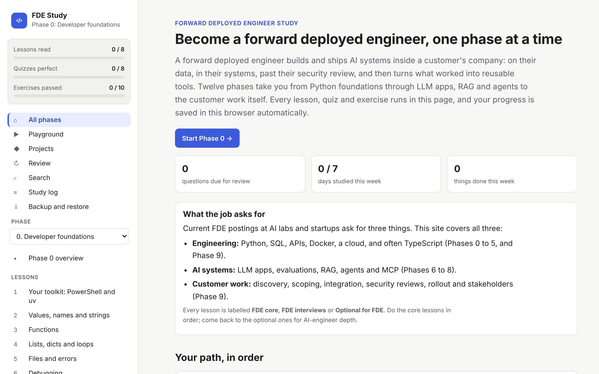
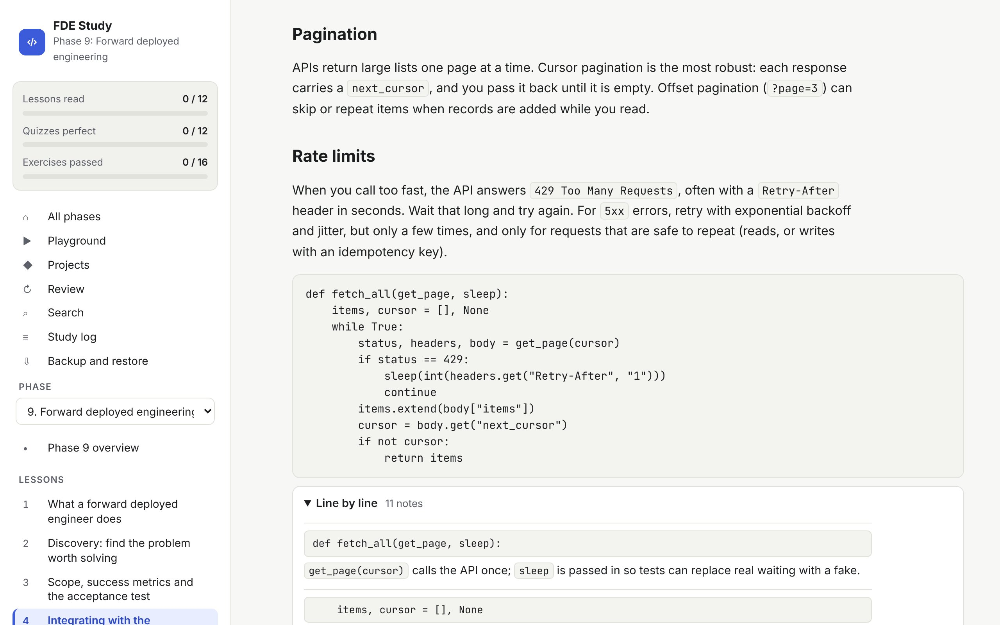
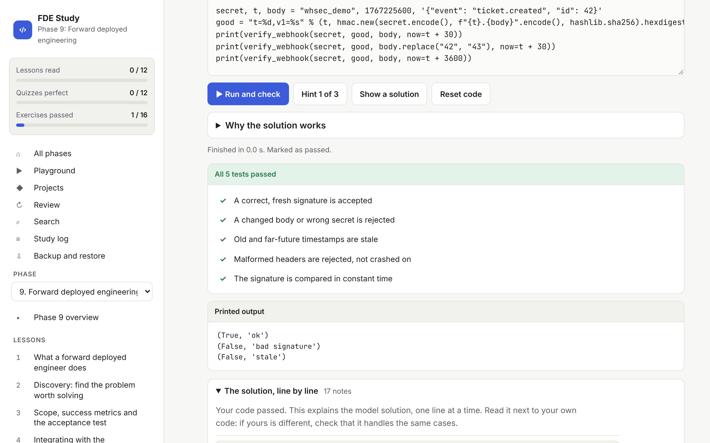
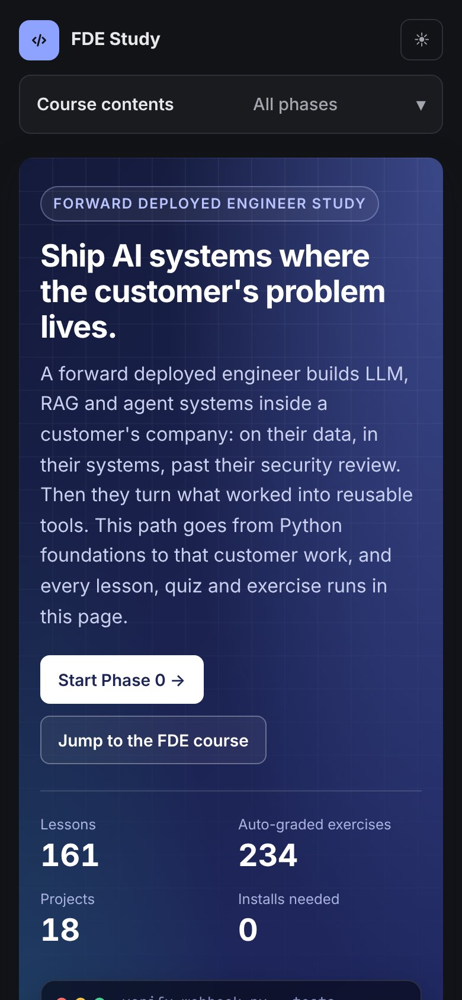

# Forward Deployed Engineer Study

[](https://ahmed-fde-study.netlify.app)
-3776AB?style=flat-square&logo=python&logoColor=white)


**A study platform I built to train myself as a forward deployed engineer (FDE): 161 lessons, 234 auto-graded exercises in Python and JavaScript, and 18 projects (12 phase projects and 6 portfolio projects). Everything runs in the browser, with no install, no backend and no sign-up.**

**Live site: [ahmed-fde-study.netlify.app](https://ahmed-fde-study.netlify.app)**



## What a forward deployed engineer does

A forward deployed engineer builds and ships AI systems inside a customer's organisation, on the customer's data, in the customer's systems and past the customer's security review. Then they turn what worked into reusable tools. The job is roughly 70 % AI engineering and 30 % customer work: discovery, scoping, integration, rollout and stakeholders.

I researched current FDE postings at Anthropic, OpenAI and Palantir, plus two analyses of about 1,000 postings each. I then checked my curriculum against them and wrote a new course for the gaps. The research and gap check are in [docs/FDE-RESEARCH-AND-GAPS.md](docs/FDE-RESEARCH-AND-GAPS.md).

## The curriculum

The 12 phases are in the order an FDE should learn them. Every lesson is labelled **FDE core**, **FDE interviews** (coding-round practice) or **Optional for FDE** (AI-engineer depth to come back to).

| Phase | Course | Lessons | Exercises | What it covers |
|---:|---|---:|---:|---|
| 0 | Developer foundations | 8 | 10 | Python, files and errors, debugging, pytest, Git |
| 1 | Professional Python | 14 | 32 | Classes, typing, logging, packaging, data structures and algorithms |
| 2 | Data, SQL and analysis | 8 | 13 | SQL, pandas, messy real-world data |
| 3 | Practical math for ML | 8 | 13 | Vectors, similarity, probability, uncertainty, through code |
| 4 | Traditional machine learning | 18 | 30 | Baselines, honest evaluation, precision and recall, drift, A/B tests |
| 5 | Shipping models | 17 | 24 | APIs, validation, auth, Docker, CI/CD, queues, tracing, SLOs |
| 6 | LLM application engineering | 15 | 21 | Prompts, structured output, cost, evaluations, guardrails, tool calling |
| 7 | Retrieval and RAG | 17 | 19 | Chunking, BM25 and vector search, reranking, RAG evaluation, access control |
| 8 | Production AI systems and agents | 16 | 19 | Agents, MCP servers, permissions, tracing, planning |
| **9** | **Forward deployed engineering** | **12** | **16** | **Discovery, scoping, customer APIs, security reviews, cloud choices, TypeScript, rollout, stakeholders** |
| 10 | Deep learning fundamentals | 18 | 25 | Neural networks, embeddings, attention, transformers |
| 11 | Career readiness | 10 | 12 | Portfolio, resume, interviews, including FDE rounds |

Every lesson has a three-question quiz with an explanation for each answer (483 questions). Every phase ends with a project and a checkpoint. There are also 6 standalone portfolio projects with their own tests.

### Phase 9: Forward deployed engineering

This course covers the customer half of the job, which most AI curricula skip:

- **Discovery and scoping:** turn a vague ask into success metrics, a scope document and an acceptance test that decides "done".
- **Integrating with customer systems:** cursor pagination, `429` and `Retry-After`, exponential backoff, HMAC-signed webhooks checked in constant time, OAuth 2 token caching, mapping a customer's schema to yours.
- **Security and regulated customers:** PII redaction with Luhn-checked card numbers, tamper-evident hash-chained audit logs, data residency, least privilege.
- **Deploying in the customer's cloud:** choosing between SaaS, a dedicated tenant, the customer's VPC and on-prem, with honest trade-offs, and estimating monthly LLM cost.
- **JavaScript and TypeScript:** enough to change a customer's web app or write an MCP-style tool handler. These exercises run in the page.
- **Pilot to production:** canary decisions (promote, hold or roll back), runbooks and handoff.
- **Demos, writing and stakeholders:** status updates a customer can act on.
- **Codifying patterns:** turning one customer's script into a configurable, reusable tool.
- **Capstone:** a simulated customer pilot from start to finish. It fetches a rate-limited API, rejects bad rows, redacts personal data, classifies tickets, scores them against the agreed acceptance criteria, makes a go or no-go decision and keeps a verifiable audit log.



## Features

- **Real code in the browser.** Python runs through [Pyodide](https://pyodide.org) (CPython compiled to WebAssembly), including NumPy, pandas and scikit-learn. JavaScript runs in a Web Worker with a 5-second limit, so an endless loop can't freeze the page.
- **Auto-graded exercises.** Each exercise opens with a worked example from its lesson that you can edit and run, then the question and your own editor, which starts from the function header. It has named tests, three hints that open one at a time, and a model solution with a note on every line, hidden until you press **Show solution**.
- **Edit and run any lesson example.** Code blocks open in an editor next to the text. Examples that can't run in a browser, such as servers, say why and can be downloaded.
- **Progress that stays.** Progress, notes and drafts are saved in the browser, with backup and restore to a file.
- **Spaced review** of missed quiz questions, full-text search and a study log.
- **One-button publish to GitHub.** Press **Publish to GitHub** on any phase project, the capstone or a portfolio project: the site signs you in with GitHub once, writes the README from your code, test results and notes, and commits the code, data, tests and README to your portfolio repository in a single commit. Every item can also be downloaded as a ready-to-push .zip (tests run with `pytest`, or `node --test` for JavaScript).
- **Responsive and accessible.** Fixed navigation on desktop, a collapsible "Course contents" menu on mobile, light and dark themes, keyboard support and ARIA live regions for results.

<p align="center"> </p>

## How it is built

| Decision | Why | Trade-off |
|---|---|---|
| One self-contained `index.html` (about 4.8 MB) | Works on any static host, works offline once loaded, and can be downloaded and opened locally | A large first download; content is edited through a build script instead of a CMS |
| No framework: plain JavaScript, hash routing and template strings | No build step to keep the site alive; fast on low-end phones | More hand-written DOM code than React would need |
| Pyodide loaded on the first Run | Real CPython semantics and real libraries, with $0 hosting | The first run downloads about 10 MB; later runs are instant |
| JavaScript graded in a Web Worker | Isolated from the page, and an endless loop can be stopped | Browser JavaScript, not Node: no `fs` or `require` in exercises |
| `localStorage` for progress | Private and needs no account or server | Progress lives in one browser; backup and restore covers moving it |
| Publishing through 6 small Netlify Functions and a GitHub App | One button, no tokens in the browser: the sign-in is an encrypted HttpOnly cookie, the app only gets Contents access to repositories you pick, and each publish is one atomic commit (Git Data API) | Needs a one-time GitHub App setup (two clicks on GitHub); publishing only works on the hosted site, not when `index.html` is opened from disk |

## Quality checks

Before each release I run these checks in headless Chromium (Playwright):

- Every exercise solution passes all of its tests, and every starter fails at least one, through the real Run button. For this release that covers all 17 new Phase 9 exercises and the capstone.
- A sweep of all 622 routes checks for script errors, a missing page heading or horizontal overflow.
- Layouts are checked at 320, 375, 390, 430, 768, 1024 and 1440 px in light and dark themes.
- Progress saved by the previous version still loads after courses are renumbered.
- The JavaScript test files the site exports pass under `node --test`.

## Repository layout

```
index.html                       the whole site: content, styles and app code in one file
netlify.toml                     hosting config, API routes and security headers
netlify/functions/               GitHub sign-in, status, publish, sign-out and one-time app setup
package.json                     one dependency for the functions (@netlify/blobs, stores the app settings)
github-setup.html                one-time GitHub App setup page (for the site owner)
docs/FDE-RESEARCH-AND-GAPS.md    job-posting research, gap check and learning order
docs/screenshots/                images used in this README
```

## Run it locally

```bash
git clone https://github.com/Ahmed200444/forward-deployed-engineer-study.git
cd forward-deployed-engineer-study
python -m http.server 8000
# open http://localhost:8000
```

Opening `index.html` directly also works. Python exercises need an internet connection the first time, to download Pyodide.

## About

I'm Ahmed, and I'm working towards applied AI engineering and forward deployed engineering roles. I built this to learn the job properly, and as a working example of the kind of tool an FDE builds: something a real user relies on every day, tested and shipped. I used Claude as a pair programmer.
